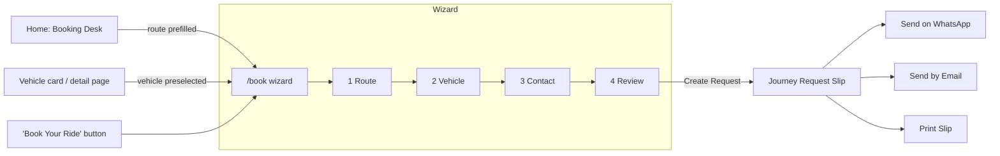

# ARCHITECTURE & TECHNICAL SPECIFICATION
## OX TOURS AND TRAVELS — Newspaper-Themed Travel & Vehicle Rental Website

---

## 1. Project Overview

**Ox Tours and Travels** is the website of a chauffeur-driven vehicle rental and tour company. The whole site is designed as a **printed newspaper**: a nameplate with a dateline, ruled columns, kickers, headlines, decks, photo captions, classified-style listings and clip-out coupons for forms.

> *"EVERY JOURNEY HAS A STORY. LET US DRIVE YOURS."*
> Tagline: *"YOUR JOURNEY. OUR RESPONSIBILITY."*

### What the site does
1. **Shows the fleet** — 8 vehicles (Innova Crysta, Tempo Travellers, Force Urbania vans, a 21-seater bus) with photos, specifications and features.
2. **Takes journey requests** — a 4-step booking wizard that ends in a printable request slip.
3. **Takes enquiries** — a contact form and a short per-vehicle enquiry form.
4. **Keeps content separate from layout** — vehicles, photos, contact details and page copy all live in `src/data/`, so they can be changed without touching components.

### Important: there is no backend
Nothing is stored on a server. When a visitor finishes a form, the site builds a complete text message and offers **Send on WhatsApp** (and **Send by Email** where relevant). The request reaches the business only when the visitor presses one of those buttons. See section 8.

---

## 2. Technology Stack

Single-page application: React 18, TypeScript, Tailwind CSS 3, Vite 6.

| Package | Purpose |
|---|---|
| `react`, `react-dom` | UI |
| `react-router-dom` (v7) | Client-side routing |
| `lucide-react` | Line icons |
| `clsx` + `tailwind-merge` | The `cn()` class-name helper (`src/lib/cn.ts`) |
| `tailwindcss`, `postcss`, `autoprefixer` | Styling pipeline |
| `typescript`, `vite`, `@vitejs/plugin-react` | Build tooling |

There is no animation library; all animations are plain CSS plus one small scroll observer (`useReveal`).

### NPM scripts
- `npm run dev` — dev server on port 3000.
- `npm run build` — type-check (`tsc`) then production build into `/dist`.
- `npm run preview` — serve the production build locally.

---

## 3. Folder Structure

The rule: **pages compose, components render, hooks hold state, lib holds logic, data holds content.**

```
src/
├── App.tsx                     # Route table only
├── main.tsx                    # DOM mount
├── styles/index.css            # Design system: base type, newspaper classes, print rules
├── types/index.ts              # Shared TypeScript types
│
├── pages/                      # One thin file per route; each just arranges components
│   ├── HomePage.tsx
│   ├── FleetPage.tsx
│   ├── VehicleDetailPage.tsx
│   ├── GalleryPage.tsx
│   ├── AboutPage.tsx
│   ├── ContactPage.tsx
│   ├── BookPage.tsx
│   └── NotFoundPage.tsx
│
├── components/
│   ├── layout/                 # The frame around every page
│   │   ├── AppLayout.tsx       # Masthead + nav + <Outlet/> + footer + floating buttons
│   │   ├── Masthead.tsx        # Nameplate, "ears", motto and dateline
│   │   ├── Navigation.tsx      # Sticky section bar
│   │   ├── MobileDrawer.tsx    # Slide-in menu for small screens
│   │   ├── Footer.tsx
│   │   ├── Page.tsx            # Standard page container (width + padding)
│   │   ├── ErrorBoundary.tsx   # Shows a notice instead of a blank screen if a page crashes
│   │   ├── ScrollRestoration.tsx  # Opens each new page at the top
│   │   └── BackToTopButton.tsx
│   │
│   ├── ui/                     # Reusable building blocks, no business knowledge
│   │   ├── Button.tsx          # Router link / external link / button, 4 variants
│   │   ├── SectionHeader.tsx   # Rule + kicker + headline + deck
│   │   ├── NewsPhoto.tsx       # Framed photo with caption and credit
│   │   ├── FormFields.tsx      # TextField, SelectField, TextAreaField (labelled, with errors)
│   │   ├── NumberStepper.tsx   # − / + number input
│   │   ├── SegmentedControl.tsx# Joined single-choice buttons
│   │   ├── FilterPills.tsx     # Category filter buttons
│   │   ├── SummaryList.tsx     # Label / value rows
│   │   ├── Reveal.tsx          # Slow scroll-in animation wrapper
│   │   ├── CountUp.tsx         # Counts a figure up from zero when it scrolls into view
│   │   ├── Notices.tsx         # EmptyState, SuccessNotice, CtaBanner
│   │   ├── Lightbox.tsx        # Fullscreen photo viewer
│   │   └── WhatsAppButton.tsx  # Floating WhatsApp icon (bottom-right)
│   │
│   ├── home/                   # Hero, QuickBookingBar, TrustBriefs, FeaturedFleet, GalleryTeaser
│   ├── fleet/                  # VehicleCard, VehicleGrid, FleetFilterBar
│   ├── vehicle/                # VehicleGallery, VehicleDetails, TariffCard, VehicleEnquiryForm
│   ├── gallery/                # GalleryCard, GalleryFilterBar
│   ├── booking/                # BookingStepper, RouteStep, VehicleStep, ContactStep, ReviewStep,
│   │                           # BookingVoucher, StepControls, StepHeading, ChoiceCard, journeySummary.ts
│   ├── contact/                # ContactForm, OfficeDetails, FaqList
│   └── about/                  # FoundingEssay, PillarsGrid
│
├── hooks/
│   ├── useBookingForm.ts       # All booking wizard state and rules
│   ├── useFleetFilters.ts      # Fleet catalogue filter + sort state
│   ├── useDialog.ts            # Modal behaviour: scroll lock, Escape, focus trap
│   ├── useScrollLock.ts
│   ├── useScrolled.ts
│   ├── useReveal.ts            # Reports when a block first scrolls into view
│   └── usePageTitle.ts         # Per-page browser tab title
│
├── lib/                        # Pure functions, no React
│   ├── cn.ts                   # Class-name helper
│   ├── contact.ts              # whatsappUrl(), telHref(), mailtoUrl()
│   ├── messages.ts             # Builds the WhatsApp / email text for each form
│   ├── bookingValidation.ts    # Validation rules for wizard steps 1–3
│   ├── validation.ts           # Phone and email checks
│   ├── dates.ts                # Date / time formatting, earliest pickup date
│   └── fleet.ts                # Vehicle lookups and capacity ranges
│
└── data/                       # All editable content
    ├── siteConfig.ts           # Brand name, phone numbers, WhatsApp number, email, address
    ├── fleetData.ts            # The 8 vehicles
    ├── galleryData.ts          # The 25 gallery photographs
    ├── navigation.ts           # Menu links
    ├── homeContent.ts          # Hero photo, hero key facts and the three briefs
    ├── aboutContent.ts         # Founding essay and the six pillars
    ├── contactContent.ts       # Service list and FAQs
    ├── bookingContent.ts       # Trip types, steps, reply options, empty form
    └── destinationData.ts, servicesData.ts, testimonialsData.ts   # Archived; not used by any page
```

---

## 4. Pages and Routes

Routes are declared in `src/App.tsx`. Every route renders inside `AppLayout`.

| Path | Page | Contents |
|---|---|---|
| `/` | `HomePage` | Hero (black headline panel + large photo + key-facts strip), booking desk, "The Ox Standard" briefs, all 8 vehicles, 4-photo gallery preview |
| `/fleet` | `FleetPage` | Full catalogue with type, keyword, group-size filters and sorting |
| `/fleet/:id` | `VehicleDetailPage` | Photo gallery, facts, write-up, specification table, features, tariff, enquiry coupon, 3 related vehicles |
| `/gallery` | `GalleryPage` | Photos at their natural shape (masonry), collection filter, search, fullscreen viewer with captions |
| `/about` | `AboutPage` | Two-column essay with drop cap, pull quote, six pillars |
| `/contact` | `ContactPage` | Enquiry coupon, office details, FAQ accordion |
| `/book` | `BookPage` | 4-step wizard ending in the journey request slip |
| `*` | `NotFoundPage` | 404 |

Each page has exactly one `<h1>` and sets its own browser title through `usePageTitle`.

---

## 5. Design System — the Newspaper Theme

### Principles
- **Square corners, no drop shadows, no gradients.** Structure comes from rules (lines), not cards.
- **One spot colour.** Black ink on warm newsprint, with press red used only for kickers and errors.
- **Photographs in full natural colour**, always inside a thin black frame, captioned where useful.

### Colours (`tailwind.config.js`)
| Token | Hex | Use |
|---|---|---|
| `paper-warm` | `#F4EBD8` | Page background colour (under the paper texture, see below) |
| `paper-white` | `#FBF6E9` | Form fields, the request slip |
| `paper-aged` | `#E9DDC2` | Photo placeholders, hover tints, light text on the dark footer |
| `paper-rule` | `#CDBF9F` | Hairline rules between columns and rows |
| `ink-black` | `#2A2124` | Text, heavy rules, primary buttons, footer |
| `ink-charcoal` | `#3A3033` | Body copy |
| `ink-muted` | `#625659` | Decks, captions, metadata |
| `ink-light` | `#9C917C` | Large numerals, small print on the dark footer |
| `press` | `#9A1B1B` | Kickers, required marks, error messages |
| `whatsapp` | `#1F8F4E` | The floating WhatsApp icon only |

### Vintage paper background
The page looks like aged newsprint. `--paper-texture` in `src/styles/index.css` stacks four layers: faded edges, fine grain, and two sizes of soft brown mottling (small inline SVGs, so no image downloads). The paper is kept light cream-beige on purpose; heavy mottling reads as dirty. `body` uses it, and the `.paper-surface` class gives the sticky nav and mobile menu the same paper. To make it calmer or stronger, change the last number in the two `feColorMatrix` lines (`-.2` grain, `-.1` fibre mottling; more negative = fainter).

`PaperEffects` adds two interactions: a soft warm light that follows the mouse on desktop, and a thin reading-progress line at the top of the screen. Ruled listings (fleet cards, pillars) also warm slightly on hover. All are off for touch screens and reduced motion.

### Scroll animation
Wrap any block in `<Reveal>` (`components/ui/Reveal.tsx`) to make it rise and fade in over about 1.1 s as it scrolls into view; it plays once. Pass `delay={stagger(index)}` for items in a row. `SectionHeader`, `VehicleGrid`, `CtaBanner` and most page blocks already use it. Styles are `.reveal` in `index.css`; timing is the two `1.1s` values. It is skipped for visitors who prefer reduced motion and is always visible when printing.

### Typographic hierarchy (follows a classic front page)
1. **Nameplate** — Anton, huge, between a double rule above and below.
2. **Dateline** — Barlow Condensed bold capitals: volume ✱ motto ✱ date, between double rules.
3. **Headline** — Libre Caslon Text capitals, regular weight (`.headline`), used by `SectionHeader`, the hero and page titles.
4. **Deck** — Libre Caslon italic under the headline (`.deck`).
5. **Subhead** — Barlow Condensed bold capitals (automatic for `h3`/`h4`): card titles, pillar names.
6. **Body** — Libre Caslon Text.
7. **Labels** — `.kicker` (red), `.folio`, `.label-caps`, all Barlow Condensed.

### Typefaces (loaded in `index.html`)
| Tailwind class | Font | Use |
|---|---|---|
| `font-nameplate` | Anton (condensed heavy sans) | The newspaper name only: huge capitals in the masthead, plus the sticky bar, mobile menu, footer and request slip. Text comes from `SITE_CONFIG.nameplate`. |
| `font-serif` | Libre Caslon Text | Headlines in large regular-weight capitals (`.headline` class); decks and pull quotes in italic |
| `font-body` (default) | Libre Caslon Text | Body copy and form text |
| `font-sans` | Barlow Condensed | Subheads (every `h3`/`h4` is condensed bold capitals), kickers, the dateline, labels, buttons, navigation |
| `font-mono` | Courier Prime | The request slip and summaries |

### Newspaper classes (`src/styles/index.css`)
| Class | What it is |
|---|---|
| `.kicker` | Small red uppercase label above a headline |
| `.folio` | Quiet uppercase metadata (section, plate number, status) |
| `.label-caps` | Form and sidebar labels |
| `.deck` | Italic standfirst under a headline |
| `.rule-thick-thin` / `.rule-thin-thick` | Double rules that open a section |
| `.rule-grid` | A grid whose cells are divided by hairlines (fleet listings, pillars, fact strip) |
| `.notice-box` | Double-framed box (booking desk, tariff, calls to action) |
| `.coupon` | Dashed "clip-out" border (every form, the request slip) |
| `.dropcap` | Large first letter of a paragraph |
| `.columns-news` + `.text-justify-news` | Justified multi-column body text |
| `.field-input` | Standard input / select / textarea styling |

### Layout rules
1. Page content sits in the `Page` component (`max-w-page` = 76rem, or `narrow` for forms).
2. Two-column pages use a 12-column grid with a hairline rule between the columns.
3. Every page section starts with a `SectionHeader`.
4. Tap targets are at least 40px tall; form text is 16px so phones do not zoom in.

---

## 6. Key Components

### Layout
- **`Masthead`** — nameplate, two "ears" (desktop only), motto, then the dateline row with today's date and the edition name.
- **`Navigation`** — sticky bar. Desktop: links centred, Book button right, compact nameplate fades in on the left after scrolling. Below 768px: a Menu button opens `MobileDrawer`.
- **`MobileDrawer`** — closes on Escape, on a tap outside, and on navigation.
- **`WhatsAppButton`** — small round icon fixed bottom-right; opens a WhatsApp chat with the business number. `BackToTopButton` sits just above it.

### UI building blocks
- **`Hero`** (`components/home`) — the front-page hero. Headline, deck and two buttons on a black panel; the photo beside it (below it on phones); a four-fact strip underneath. Text and photo come from `HERO_PHOTO` / `HERO_STATS` in `homeContent.ts`; the headline itself is in `Hero.tsx`.
- **`CountUp`** — give it the final text (`"8"`, `"7–21"`, `"100%"`) and every number in it counts up from zero once it scrolls into view. Used for the hero's four facts.
- **`Button`** — `variant`: `primary`, `secondary`, `inverse` and `inverse-outline` (for dark backgrounds), `link`. Pass `to` for an internal page, `href` for an external address, or neither for a plain button.
- **`FormFields`** — every field has a linked `<label>`, optional hint, and an error message announced to screen readers. Validation is done in code, not by the browser.
- **`Lightbox`** — arrow keys, swipe, Escape, click-outside to close; shows each photo's caption.

---

## 7. Fleet Data

All vehicles are in `src/data/fleetData.ts` and follow the `Vehicle` type in `src/types/index.ts`:

```typescript
export interface Vehicle {
  id: string;                    // URL slug, e.g. 'innova-crysta'
  name: string;
  category: VehicleCategory;     // 'Innova Crysta' | 'Tempo Traveller' | 'Force Urbania' | 'Luxury Bus / Coach'
  tagline: string;               // Italic deck under the name
  shortDescription: string;      // Card text
  fullDescription: string;       // Detail-page write-up
  passengerCapacity: number;
  luggageCapacity: number;
  featured: boolean;
  idealFor: string[];
  features: string[];
  specs: { transmission; fuelType; acType; musicSystem; seatingArrangement; chargingPorts };
  pricingPlaceholder: { rateType; indicativeRate; note };
  availabilityStatus: 'Available' | 'On Request' | 'Seasonal Demand';
  images: { main: string; gallery: string[]; alt: string };
}
```

### The 8 vehicles
| ID | Vehicle | Seats | Bags |
|---|---|---|---|
| `innova-crysta` | Toyota Innova Crysta | 7 | 5 |
| `tempo-traveller-9-seater` | 9-Seater Tempo Traveller | 9 | 9 |
| `tempo-traveller-12-seater-luxury` | 12-Seater Luxury Tempo Traveller | 12 | 12 |
| `tempo-traveller-17-seater` | 17-Seater Tempo Traveller | 17 | 16 |
| `luxury-bus-21-seater` | 21-Seater Luxury Bus | 21 | 22 |
| `force-urbania-9-seater-luxury` | 9-Seater Luxury Urbania (Executive Class) | 9 | 10 |
| `force-urbania-12-seater-luxury` | 12-Seater Luxury Urbania | 12 | 12 |
| `force-urbania-16-seater-luxury` | 16-Seater Luxury Urbania | 16 | 15 |

Photos are in `public/gallery/`.

---

## 8. Booking and Enquiry Flow



### Where the logic lives
- **State and step movement:** `hooks/useBookingForm.ts`
- **Validation rules:** `lib/bookingValidation.ts`
- **Message text:** `lib/messages.ts`
- **Each step's screen:** `components/booking/*Step.tsx`

### Rules enforced
| Step | Checks |
|---|---|
| 1 Route | Pickup required; destination required unless "Local City Rental"; departure tomorrow or later; return not before departure |
| 2 Vehicle | Vehicle type required; the guest count must fit the chosen model (or the largest vehicle of the chosen type). Types too small for the group are disabled. Changing type clears a model that no longer belongs. |
| 3 Contact | Name, mobile number and email follow the field rules below. Email is optional unless the visitor asks for an email reply. |

### Name, phone and email rules (every form)
Defined once in `src/lib/validation.ts` and used by the booking wizard, the contact form and the vehicle enquiry form.

| Field | While typing | On submit |
|---|---|---|
| Name | Only letters and spaces can be entered; digits and symbols are removed and an error explains why | Required; letters only |
| Mobile number | Only digits can be entered, up to 10; anything else is removed with an error | Required; exactly 10 digits |
| Email (optional) | Only letters, numbers and `. _ % + - @` can be entered, with one `@` | If filled, must look like `name@gmail.com` |

To change a rule, edit `restrictInput` (typing) and the `isValid…` / `…Error` functions (submit) in that one file.
| 4 Review | Read-only summary with an Edit link back to each step |

The forward button is always the form's submit button, so pressing Enter in a field advances a step.

### After "Create Request"
A request number (`OX-REQ-<year>-<4 digits>`) is generated in the browser and the slip is shown. The visitor must then press **Send on WhatsApp** or **Send by Email** for the business to receive it. The contact form and the vehicle enquiry form work the same way.

---

## 9. Interaction Details

- **Page changes** open at the top instantly and fade in (`.page-enter`).
- **Printing** (`window.print()` on the slip): the masthead, navigation, footer and floating buttons carry Tailwind's `print:hidden`, so only the slip prints.
- **Reduced motion:** animations are switched off when the visitor's device asks for reduced motion.
- **Keyboard:** a "Skip to content" link is the first focusable element; overlays trap focus and return it on close.

---

## 10. Responsive Behaviour

| Width | Behaviour |
|---|---|
| ≥ 1024px | Two-column pages with a rule between columns; 3-column fleet grid; masthead ears visible |
| 768–1023px | Single-column pages; 2-column fleet grid; full navigation links |
| < 768px | Menu button + drawer; single-column grids; forms stack to one field per row; nameplate scales with the screen width |

---

## 11. SEO

- One `<h1>` per page and a unique title per page (`usePageTitle`).
- `index.html` holds the description, Open Graph and Twitter tags; the preview image is one of the company's own photographs.
- `public/robots.txt` allows all crawlers and points to the sitemap.
- `public/sitemap.xml` lists the 6 main pages and all 8 vehicle pages. **Add a line when a vehicle is added.**

The web address `https://oxtoursandtravels.com` is written into `index.html` (Open Graph tags), `robots.txt` and `sitemap.xml`. **If the site goes live on a different address, change it in those three files.**

### Deployment (Vercel)

`vercel.json` in the project root configures the deployment:

- **Build** — `npm run build`, output folder `dist`.
- **Page addresses** — every address that is not a real file is served `index.html`, so refreshing `/fleet` or opening a shared vehicle link works. Missing files under `/assets`, `/gallery` and `/vehicles` return a real 404.
- **Security headers** on every response — a strict Content-Security-Policy (scripts only from this site; styles and fonts only from this site and Google Fonts; images only from this site), plus `X-Frame-Options: DENY`, `X-Content-Type-Options`, `Referrer-Policy`, `Strict-Transport-Security` and `Permissions-Policy`.
- **Caching** — the hashed files in `/assets` are cached for a year; photographs for a day.

**If you add anything loaded from another website** (an analytics script, a map embed, photos hosted elsewhere), add that website to the Content-Security-Policy in `vercel.json`, or the browser will block it.

There are no logins, secret keys or environment variables: the site has no backend, so there is nothing to configure in the Vercel dashboard beyond importing the repository.

---

## 12. Current Status

| Area | Status |
|---|---|
| Newspaper design system | ✅ Complete |
| All 8 routes | ✅ Complete |
| Fleet catalogue, filters, detail pages | ✅ Complete |
| Gallery with fullscreen viewer | ✅ Complete |
| Booking wizard, request slip, print | ✅ Complete |
| Contact and vehicle enquiry forms | ✅ Complete (delivery by WhatsApp / email link) |
| Production build | ✅ `npm run build` passes with 0 errors |
| Vercel deployment config and security headers | ✅ `vercel.json` |
| Dependency security check | ✅ `npm audit` reports 0 vulnerabilities |
| Real contact details | ⏳ **Placeholders** — see section 14A |
| Backend / stored requests | ⏳ Not built |

---

## 13. Future Roadmap

1. **Real business details** in `siteConfig.ts` (phone, WhatsApp number, email, address).
2. **Backend for requests** so bookings are stored and the desk is notified automatically, without the visitor's extra tap.
3. **Image optimisation** — convert `public/gallery` photos to WebP and give the files short, descriptive names.
4. **Live tariff estimates** from a distance API.
5. **CMS** for the fleet and gallery data.

---

## 14. Developer Guide

### A. Change contact details or the WhatsApp number
Edit `src/data/siteConfig.ts`. `whatsappNumber` is digits only, country code first, no `+` (for example `919812345678`). Every WhatsApp button, including the floating icon, is built from this one value by `src/lib/contact.ts`.

### B. Add a vehicle
1. Append an object to `FLEET_DATA` in `src/data/fleetData.ts`.
2. For a new type, also add it to `FLEET_CATEGORIES` there, to `VehicleCategory` in `src/types/index.ts`, and to `CATEGORY_BLURBS` in `src/data/bookingContent.ts`.
3. Add its URL to `public/sitemap.xml`.

It then appears on the home page, the catalogue, the booking wizard and the footer automatically.

### C. Add a gallery photo
Put the file in `public/gallery/` and append an entry to `GALLERY_DATA` in `src/data/galleryData.ts`. Set `aspectRatio` to match the photo's shape.

### D. Change page copy
Front page: `homeContent.ts`. About: `aboutContent.ts`. FAQs and service list: `contactContent.ts`. Booking labels: `bookingContent.ts`. Menu: `navigation.ts`.

### E. Add a new page
1. Create `src/pages/NewPage.tsx`: call `usePageTitle`, wrap content in `<Page>`, start with `<SectionHeader as="h1" …>`.
2. Add the route in `src/App.tsx` and a link in `src/data/navigation.ts`.

### F. Conventions
- A component that grows past roughly 150 lines, or that mixes state rules with markup, should be split: rules go to a hook or `lib/`, repeated markup to `components/ui/`.
- Use the newspaper classes from section 5 instead of new one-off styles. No rounded corners or shadows (the WhatsApp icon is the single exception).
- Run `npm run build` before committing; unused variables and imports fail the build.
