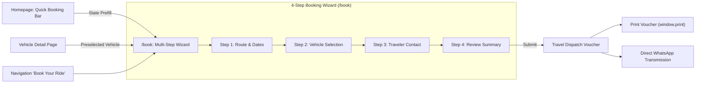

# ARCHITECTURE & TECHNICAL SPECIFICATION
## OX TOURS AND TRAVELS — Premium Editorial Travel & Vehicle Rental Platform

---

## 1. Project Overview & Business Purpose

**OX TOURS AND TRAVELS** is a digital platform for a luxury travel agency and tourist transportation company. The website combines a **newspaper-inspired editorial aesthetic** (reminiscent of broadsheet publications such as *The New York Times*, *Monocle*, and vintage travel gazettes) with modern luxury automobile rental capabilities.

### Core Brand Philosophy
> *"EVERY JOURNEY HAS A STORY. LET US DRIVE YOURS."*  
> Tagline: *"YOUR JOURNEY. OUR RESPONSIBILITY."*  
> Publication Descriptor: *"TRAVEL • COMFORT • DISCOVERY • EXPERIENCE"*

### Primary Business Objectives
1. **Chauffeured Vehicle Rental**: Providing private sedans, luxury SUVs, Innova MUVs, Force Urbania luxury vans, Tempo Travellers, and touring coaches.
2. **Comprehensive Travel Services**: Outstation inter-city trips, local hourly rentals, airport and express terminal transfers, corporate delegations, family tours, wedding convoys, and bespoke tour packages.
3. **Frictionless Frontend Requisitions**: Multi-step booking enquiry system allowing guests to configure routes, select vehicle tiers, specify passenger requirements, and generate an official dispatch voucher without payment friction.
4. **Editable & Extensible Architecture**: Decoupling vehicle specs, pricing placeholders, destination essays, and business contact information into centralized data modules so photography, rates, and operational endpoints can be updated effortlessly without touching UI components.

---

## 2. Technology Stack & Dependencies

The project is built as a single-page application (SPA) using React 18, TypeScript, Tailwind CSS, and Vite.

### Core Runtime Dependencies
| Package | Version | Purpose |
|---|---|---|
| `react` | `^18.3.1` | Declarative UI framework |
| `react-dom` | `^18.3.1` | React DOM bindings |
| `react-router-dom` | `^6.29.0` | Client-side declarative multi-page routing |
| `lucide-react` | `^0.475.0` | Lightweight SVG line icons (automotive, navigation, UI controls) |
| `clsx` | `^2.1.1` | Conditional className concatenation utility |
| `tailwind-merge` | `^3.0.1` | Conflict-free Tailwind class resolution |
| `framer-motion` | `^11.18.2` | Motion primitives and animated transitions |

### Developer & Build Tooling
| Tool | Version | Purpose |
|---|---|---|
| `vite` | `^6.1.0` | Next-generation ESM bundler and development server |
| `@vitejs/plugin-react` | `^4.3.4` | Fast Refresh and JSX transformation |
| `typescript` | `^5.7.3` | Static typing, interface contracts, and compiler checks |
| `tailwindcss` | `^3.4.17` | Utility-first CSS engine with custom color extensions |
| `postcss` | `^8.5.2` | CSS post-processing pipeline |
| `autoprefixer` | `^10.4.20` | Vendor prefix generation for cross-browser support |

### NPM Scripts
- `npm run dev`: Starts Vite dev server with Hot Module Replacement (configured on port `3000` with `--host` exposed).
- `npm run build`: Executes TypeScript verification (`tsc`) followed by the Vite production build (`vite build`), outputting optimized assets to `/dist`.
- `npm run preview`: Previews the production build locally.

---

## 3. Complete Folder and File Structure

```
f:\ox tours and travels\
├── public/
│   ├── robots.txt                    # Search crawler instructions (Allow all, points to sitemap)
│   └── sitemap.xml                   # XML sitemap indexing all 8 active public routes
├── src/
│   ├── components/
│   │   ├── fleet/
│   │   │   ├── FleetFilterBar.tsx    # Category pills, keyword search, capacity & sort dropdowns
│   │   │   └── VehicleCard.tsx       # Automotive magazine card with capacity pills & CTAs
│   │   ├── home/
│   │   │   ├── FeaturedDestinations.tsx # 3-column travel magazine cards with distance guides
│   │   │   ├── FeaturedFleet.tsx     # Editorial fleet showcase with category classifications
│   │   │   ├── FinalCTA.tsx          # High-impact closing dispatch with call & booking CTAs
│   │   │   ├── HeroCoverStory.tsx    # Broadsheet front-page lead with headline & 3-pillar trust bar
│   │   │   ├── QuickBookingBar.tsx   # Fast 3-mode journey requisition card (Outstation, Local, Airport)
│   │   │   ├── ServicesOverview.tsx  # Grid of 6 core travel services with benefit checklists
│   │   │   ├── Testimonials.tsx      # Dispatch correspondence and sample customer quotes
│   │   │   └── WhyChooseUs.tsx       # 4 foundational editorial pillars with minimalist line icons
│   │   ├── layout/
│   │   │   ├── Footer.tsx            # Newspaper colophon, directory links, and dispatch contacts
│   │   │   ├── Masthead.tsx          # Grand broadsheet masthead with date, volume, and taglines
│   │   │   ├── Navigation.tsx        # Sticky navbar with desktop links, mobile drawer, and CTA
│   │   │   └── ScrollToTop.tsx       # Route change scroll restoration & floating Back-to-Top button
│   │   └── ui/
│   │       ├── Badge.tsx             # Vintage stamp and ink pill badges
│   │       ├── Button.tsx            # Standardized editorial button variants (primary, accent, outline)
│   │       ├── EditorialSectionHeader.tsx # Reusable section title with section numbers & subtitles
│   │       ├── Lightbox.tsx          # Fullscreen accessible image viewer with keyboard navigation
│   │       └── WhatsAppButton.tsx    # Floating quick-action dispatch line to WhatsApp
│   ├── data/
│   │   ├── destinationData.ts        # Centralized destination essays, circuits, and photo galleries
│   │   ├── fleetData.ts              # Vehicle models, seating capacities, specs, and tariff placeholders
│   │   ├── servicesData.ts           # 7 transit tiers with benefits and use-case recommendations
│   │   ├── siteConfig.ts             # Brand wordmark, contact numbers, email, addresses, and pillars
│   │   └── testimonialsData.ts       # Sample editorial guest dispatches and review citations
│   ├── pages/
│   │   ├── AboutPage.tsx             # Brand chronicle, 2-column editorial story, and 6 operational pillars
│   │   ├── BookPage.tsx              # 4-Step multi-stage booking wizard & voucher generator
│   │   ├── ContactPage.tsx           # Validated dispatch form, office details, and cartographic map canvas
│   │   ├── DestinationsPage.tsx      # Travel essay library with categories, search, and photo lightboxes
│   │   ├── FleetPage.tsx             # Complete vehicle catalogue with live multi-filter engine
│   │   ├── HomePage.tsx              # Front-page composition orchestrating all home sections
│   │   ├── ServicesPage.tsx          # Alternating magazine layout detailing all 7 travel services
│   │   └── VehicleDetailPage.tsx     # Technical specification sheet, photo gallery, and reservation form
│   ├── styles/
│   │   └── index.css                 # Tailwind directives, editorial rules, drop caps, and print styles
│   ├── types/
│   │   └── index.ts                  # TypeScript interfaces for Vehicles, Destinations, Bookings, Forms
│   ├── App.tsx                       # Root router configuration and layout wrapper
│   └── main.tsx                      # Application DOM mount entry point
├── dist/                             # Compiled production bundle (HTML, JS, CSS)
├── index.html                        # Base HTML document with Google Fonts and Open Graph tags
├── package.json                      # Dependency declarations and npm scripts
├── postcss.config.js                 # PostCSS configuration for Tailwind and Autoprefixer
├── tailwind.config.js                # Custom palette, typography families, and box shadows
├── tsconfig.json                     # TypeScript compiler options (bundler mode, strict)
├── tsconfig.node.json                # TypeScript node configuration for Vite
└── vite.config.ts                    # Vite build configuration (port 3000, host: true)
```

---

## 4. Website Pages and Routing Architecture

Routing is managed via `react-router-dom` in [`src/App.tsx`](file:///f:/ox%20tours%20and%20travels/src/App.tsx). Every route is clean, predictable, and fully deep-linkable.

| URL Path | Component | Purpose & Features |
|---|---|---|
| `/` | `HomePage` | The front page cover story, quick booking bar, fleet preview, trust manifesto, destinations, services, testimonials, and final call-to-action. |
| `/fleet` | `FleetPage` | Interactive vehicle directory with category filtering, live search, passenger capacity filters (Up to 7, 8–12, 13–17, 18+), and sorting options. |
| `/fleet/:id` | `VehicleDetailPage` | In-depth technical dossier for a specific vehicle by ID (`innova-crysta`, `tempo-traveller-9-seater`, `tempo-traveller-12-seater-luxury`, `tempo-traveller-17-seater`, `luxury-bus-21-seater`, `force-urbania-9-seater-luxury`, `force-urbania-12-seater-luxury`, `force-urbania-16-seater-luxury`). Includes image gallery, fullscreen lightbox, full mechanical specs, cabin amenities, and direct enquiry form. |
| `/services` | `ServicesPage` | Alternating image-and-text editorial magazine layout detailing all 7 transit tiers with benefits, inclusions, and direct booking links. |
| `/destinations` | `DestinationsPage` | Travel discovery guide categorized by topography (Hill Station, Heritage, Coastal, Wildlife, Pilgrimage) with interactive photo lightboxes and route advice. |
| `/about` | `AboutPage` | Brand storytelling in a two-column broadsheet format with drop caps, core philosophy pull quotes, and the Six Pillars of the Ox travel approach. |
| `/contact` | `ContactPage` | Telegram-styled inquiry form with real-time field validation, operational office details, direct WhatsApp CTA, FAQs, and a styled map canvas placeholder. |
| `/book` | `BookPage` | 4-Stage journey requisition wizard (Route -> Vehicle -> Traveler -> Review) culminating in a printable travel dispatch voucher. Accepts pre-filled route state from `QuickBookingBar` and `VehicleDetailPage`. |
| `*` | `NotFoundPage` | 404 fallback page styled as an editorial "Road Terminus Reached" notice with shortcuts back to the front page and fleet catalogue. |

---

## 5. UI/UX Design System & Theme

The website adheres to a **Black & White Glossy Luxury Newspaper Editorial Aesthetic**: classic journalism layout rules combined with high-fashion monochrome photography, piano-black glossy surfaces, porcelain white highlights, and subtle glass sheens.

### Color Palette

Defined in [`tailwind.config.js`](file:///f:/ox%20tours%20and%20travels/tailwind.config.js):

| Color Name | Hex Code | Tailwind Utility | Visual Purpose |
|---|---|---|---|
| **Piano Black** | `#0A0A0A` | `text-ink-black`, `bg-ink-black` | Core primary typography, high-gloss buttons, dark card surfaces |
| **Porcelain White** | `#FFFFFF` | `bg-white`, `text-white` | Glossy card surfaces, high-contrast badges, specular highlights |
| **Warm Ivory** | `#F7F6F3` | `bg-paper-warm` | Page canvas background, input backgrounds |
| **Charcoal** | `#1A1A1A` | `text-ink-charcoal` | Secondary headers, image container backgrounds |
| **Subtle Grey** | `#5A5A5A` | `text-ink-muted` | Meta information, captions, helper text, timestamps |
| **Light Silver** | `#E2E8F0` | `border-ink-black/15` | Fine glossy borders and hairline dividers |

### Luxury Glossy Visual Effects
- **`.glossy-card`**: High-gloss magazine card surface with fine hairline border (`1px solid rgba(10, 10, 10, 0.12)`), top specular highlight (`inset 0 1px 0 rgba(255, 255, 255, 1)`), and smooth lift on hover.
- **`.glossy-dark`**: Piano-black linear gradient surface (`#1A1A1A` to `#0A0A0A`) with subtle top specular highlight (`inset 0 1px 0 rgba(255, 255, 255, 0.2)`).
- **`.glossy-btn-black`**: Piano-black buttons featuring an animated light sweep reflection sheen on hover.
- **`.bw-gloss-img`**: High-contrast black and white photography filter (`grayscale(100%) contrast(118%) brightness(96%)`) with smooth scale and brightness lift on hover.
- **`.glass-reflection`**: Subtle diagonal light reflection gradient over automotive and scenic photography frames.

### Typography Hierarchy

Configured via Google Fonts in [`index.html`](file:///f:/ox%20tours%20and%20travels/index.html):
- **Display & Headlines (`font-serif`)**: *Playfair Display* and *Bodoni Moda*. Used for mastheads, section titles, card names, pull quotes, and drop caps. High-contrast serifs convey prestige and classic journalism.
- **Body & Controls (`font-sans`)**: *Inter* and *DM Sans*. Clean, highly legible sans-serif for long-form paragraphs, bullet lists, form labels, and buttons.
- **Publication Stamps & Dates (`font-mono`)**: *JetBrains Mono*. Monospaced precision for dates, volume numbers, technical specs, capacity counts, and status indicators.

### Layout & Spacing Rules
1. **Breathing Room**: Major page sections utilize `py-20` to `py-24` on desktop and `py-12` on mobile to prevent claustrophobic density.
2. **Subtle Hairlines**: Section separations use soft hairlines (`border-b border-ink-black/10` or `/15`) rather than harsh heavy black outlines.
3. **Card Consistency**: Cards feature rounded corners (`rounded-lg`), subtle borders (`border-ink-black/15`), and soft elevation on hover (`hover:shadow-md hover:-translate-y-0.5`).
4. **Natural Color Photography**: Photography avoids harsh 100% grayscale filters in favor of natural contrast and rich tones with smooth scale transitions (`group-hover:scale-105 duration-500`).

---

## 6. Reusable Components & Responsibilities

All reusable components reside in `src/components/`:

### Layout Components (`src/components/layout/`)
- **`Masthead.tsx`**: Renders the broadsheet masthead with live calendar formatting, volume badge, legal edition tag, oversized brand wordmark, and tagline.
- **`Navigation.tsx`**: Sticky navigation bar that switches background opacity on scroll, highlights active routes, provides WhatsApp & Book Now buttons, and houses the responsive mobile drawer.
- **`Footer.tsx`**: Broadside footer containing the editorial colophon, full page directory, services list, configurable dispatch contact data, and copyright notice.
- **`ScrollToTop.tsx`**: Handles window scroll restoration on React Router route changes, and provides a floating Back-to-Top button that fades in after 400px of scroll.

### UI Primitives (`src/components/ui/`)
- **`EditorialSectionHeader.tsx`**: Standardized section header accepting `label`, `title`, `subtitle`, `number`, and `align` (`left` or `center`).
- **`Button.tsx`**: Versatile button/link component supporting variants (`primary`, `accent`, `outline`, `secondary`, `ghost`), sizes (`sm`, `md`, `lg`), internal router links (`to`), and external links (`href`).
- **`Badge.tsx`**: Vintage stamp and pill tags for categories, statuses, and editions.
- **`Lightbox.tsx`**: Accessible modal lightbox with keyboard shortcuts (`Escape`, `ArrowLeft`, `ArrowRight`), image slide indicators, and captions.
- **`WhatsAppButton.tsx`**: Floating bottom-left WhatsApp button with live pulse indicator linking directly to the dispatch line.

### Fleet Components (`src/components/fleet/`)
- **`VehicleCard.tsx`**: Reusable automotive card rendering vehicle thumbnail, category pill, availability badge, seating capacity, luggage count, specs, and dual CTA buttons.
- **`FleetFilterBar.tsx`**: Filter header featuring category pills, keyword search input, passenger capacity dropdown, and sort selector.

---

## 7. Vehicle Rental Catalogue & Data Structure

Vehicle data is centralized in [`src/data/fleetData.ts`](file:///f:/ox%20tours%20and%20travels/src/data/fleetData.ts) adhering to the `Vehicle` interface in [`src/types/index.ts`](file:///f:/ox%20tours%20and%20travels/src/types/index.ts).

### Vehicle Schema Contract
```typescript
export interface Vehicle {
  id: string;                               // Unique URL slug (e.g. 'force-urbania-luxury')
  name: string;                             // Display title
  category: VehicleCategory;                // Category tier
  tagline: string;                          // Editorial one-sentence hook
  shortDescription: string;                 // 2-line catalogue card overview
  fullDescription: string;                  // In-depth editorial vehicle essay
  passengerCapacity: number;                // Max guest seating
  luggageCapacity: number;                  // Suitcase capacity count
  featured: boolean;                        // Shown in homepage featured grid
  idealFor: string[];                       // Circuit tags (e.g. 'Hill Station Expeditions')
  features: string[];                       // Bulleted cabin amenities
  specs: {
    transmission: string;                   // Transmission & drive style
    fuelType: string;                       // Powertrain type
    acType: string;                         // Climate control details
    musicSystem: string;                    // Audio & PA equipment
    seatingArrangement: string;              // Seating configuration (e.g. 2+2 captain chairs)
    chargingPorts: string;                  // USB & charging connectivity
  };
  pricingPlaceholder: {
    rateType: string;                       // Structure description
    indicativeRate: string;                 // 'Tariff On Request'
    note: string;                           // Tariff disclaimer & terms
  };
  availabilityStatus: 'Available' | 'On Request' | 'Seasonal Demand';
  images: {
    main: string;                           // Primary display photo
    gallery: string[];                      // Multi-plate gallery array
    alt: string;                            // Accessible alt description
  };
}
```

### Owner's Configured Vehicle Fleet (8 Specific Models)
1. **Toyota Innova Crysta** (`innova-crysta`): 7 Passengers, 5 Bags. The gold standard for family outstation trips, airport transfers, and corporate executive travel.
2. **9-Seater Tempo Traveller** (`tempo-traveller-9-seater`): 9 Passengers, 9 Bags. Intimate group luxury with wide pushback recliners, walk-through aisle, and deep luggage hold.
3. **12-Seater Luxury Tempo Traveller** (`tempo-traveller-12-seater-luxury`): 12 Passengers, 12 Bags. Maharaja-style luxury recliners and ducted AC for joint family pilgrimages and vacation tours.
4. **17-Seater Tempo Traveller** (`tempo-traveller-17-seater`): 17 Passengers, 16 Bags. High capacity, wide central aisle, and heavy-duty commercial stamina for weddings and extended delegations.
5. **21-Seater Luxury Bus** (`luxury-bus-21-seater`): 21 Passengers, 22 Bags. Air-suspended highway cruising with massive underbelly luggage bays and panoramic windows for large wedding and corporate groups.
6. **9-Seater Luxury Urbania (Executive Class)** (`force-urbania-9-seater-luxury`): 9 Passengers, 10 Bags. Ultra-luxurious VIP cabin with Maharaja reclining captain chairs, over 6-foot standing clearance, and whisper-quiet monocoque chassis.
7. **12-Seater Luxury Urbania** (`force-urbania-12-seater-luxury`): 12 Passengers, 12 Bags. European aerodynamic styling with independent suspension, ergonomic recliners, and personal USB ports.
8. **16-Seater Luxury Urbania** (`force-urbania-16-seater-luxury`): 16 Passengers, 15 Bags. Full standing-height luxury van offering supreme highway comfort and limousine composure for medium-to-large contingents.

---

## 8. Booking and Enquiry Flow

The booking experience provides an intuitive, friction-free requisition pipeline across both quick entry points and a comprehensive multi-step wizard.



### Step Breakdown in `BookPage.tsx`
1. **Step 1: Route & Schedule**:
   - Trip classification: *Outstation Tour*, *Local City Rental*, *Airport Transfer*, *Curated Circuit*.
   - Pickup point, destination (optional for local hourly), departure date, return date, and departure time.
2. **Step 2: Vehicle Selection**:
   - Interactive category cards with capacity indicators.
   - Passenger count and luggage bag counters.
   - Special in-cabin requests (booster seats, senior boarding, roof carriers).
3. **Step 3: Traveler Contact**:
   - Full legal name, mobile phone number, email address.
   - Communication preference selector (*WhatsApp Message*, *Phone Call*, *Email Statement*).
4. **Step 4: Review & Transmit**:
   - Summary card formatted like an editorial boarding pass.
   - Generates unique requisition identifier (e.g. `OX-REQ-2026-4891`).
   - Confirmation screen featuring printable voucher and pre-filled WhatsApp message link.

---

## 9. Animations and Interactive Functionality

- **Smooth Scrolling**: Global CSS `scroll-smooth` enabled on `<html>`.
- **Image Lightbox**: Fully custom modal in `src/components/ui/Lightbox.tsx` with smooth backdrop blur, keyboard listeners (`Escape` to close, arrows to cycle), and slide counters.
- **Scroll Detection**: Navigation bar listens to window scroll with passive event listeners, dynamically applying glassmorphism and revealing the compact brand mark.
- **Print Optimization**: Dedicated `@media print` rules in `src/styles/index.css` hiding headers, navigation, buttons, and floating widgets, leaving a clean black-and-white travel voucher suitable for paper printing.
- **Direct WhatsApp Deep Links**: Pre-formatted text generation across cards, details, and booking confirmation, opening direct chats with the dispatch coordinator.

---

## 10. Responsive Design Strategy

The application employs a mobile-first responsive architecture:

- **Desktop (>= 1024px)**: Full multi-column editorial broadsheet layout, 3-column fleet grids, full navigation bar with direct WhatsApp and Booking buttons.
- **Tablet (768px - 1023px)**: 2-column fleet grids, collapsible sidebars, multi-column editorial articles transitioning from 2 columns to single column when reading.
- **Mobile (< 768px)**:
  - Masthead scales typography smoothly (`text-3xl` to `text-7xl`) using responsive font classes.
  - Desktop navigation collapses into an accessible slide-over drawer with generous touch targets (minimum 44px height).
  - Quick Booking Bar stacks cleanly into full-width input fields.
  - Multi-step booking stepper switches from 4 side-by-side cards to a 2x2 grid.
  - Horizontal overflow is prevented globally via `overflow-x-hidden` on `body`.

---

## 11. SEO and Performance Implementation

### Semantic HTML & Document Head
- Semantic heading structure: Single `<h1>` per page, sequential `<h2>` to `<h4>` hierarchy.
- Open Graph tags configured in `index.html` for Facebook, LinkedIn, and messaging link previews.
- Twitter Card metadata (`summary_large_image`).
- Favicon configured via an inline SVG data URI representing the black-and-ivory `OX` monogram.

### Crawlability Assets
- [`public/robots.txt`](file:///f:/ox%20tours%20and%20travels/public/robots.txt):
  ```
  User-agent: *
  Allow: /
  Sitemap: https://oxtoursandtravels.com/sitemap.xml
  ```
- [`public/sitemap.xml`](file:///f:/ox%20tours%20and%20travels/public/sitemap.xml): Indexes all canonical routes (`/`, `/fleet`, `/services`, `/destinations`, `/about`, `/contact`, `/book`).

### Asset Optimization
- Images use `loading="lazy"` on below-the-fold cards.
- Font preconnections (`preconnect`) to `fonts.googleapis.com` and `fonts.gstatic.com`.
- Production bundle compiled into gzipped chunks: `dist/assets/index-*.js` (~95 kB gzip) and `dist/assets/index-*.css` (~6.5 kB gzip).

---

## 12. Current Implementation Status

| Feature / Module | Status | Notes |
|---|---|---|
| Complete 8-Page Routing | ✅ Complete | Home, Fleet, Vehicle Details, Services, Destinations, About, Contact, Book, 404 |
| Editorial Newspaper Theme | ✅ Complete | Broadside masthead, refined rules, dropcaps, custom typography, ivory/ink palette |
| Fleet Catalogue & Filters | ✅ Complete | Category filter, search filter, capacity filter, sorting, reset filters |
| Vehicle Detail View | ✅ Complete | Multi-photo gallery, specifications table, features checklist, reservation form |
| Multi-Step Booking Wizard | ✅ Complete | 4 steps, validation, summary voucher, print stylesheet, WhatsApp prefill |
| Quick Booking Bar | ✅ Complete | 3-tab journey selector pre-filling full booking flow |
| Contact Form | ✅ Complete | Field validation, feedback state, business details, map placeholder |
| Responsive Layout | ✅ Complete | Tested and adapted for Mobile, Tablet, Laptop, and Desktop |
| Production Build | ✅ Complete | Tested with `npm run build` (`✓ 1623 modules transformed`, 0 errors) |
| Live Dev Server | ✅ Running | Active daemon on port 3000 (`http://localhost:3000/`) |

---

## 13. Pending Tasks & Future Roadmap

When transitioning this platform to live production deployment with real business assets:

1. **High-Resolution Fleet Photography**: Replace Unsplash placeholder images in `src/data/fleetData.ts` with authentic photographs of the actual vehicle fleet (exterior angles, cabin interior, seating legroom).
2. **Backend API Integration**:
   - Connect `BookPage.tsx` and `ContactPage.tsx` to an actual backend service (e.g., Node.js / Express, Supabase, Firebase, or serverless API routes).
   - Store incoming requisitions in a PostgreSQL / MongoDB database.
3. **Automated Notification Dispatch**:
   - Integrate SendGrid / Postmark for automated booking receipt emails to travelers.
   - Integrate Twilio / WhatsApp Business API for instant SMS/WhatsApp notification to dispatch staff.
4. **Live Tariff Calculator**: Connect distance estimation APIs (Google Maps Distance Matrix API) to calculate exact kilometer distances and approximate toll charges.
5. **CMS Integration**: Connect `fleetData.ts` and `destinationData.ts` to a headless CMS (Sanity, Strapi, Contentful) so agency staff can update vehicles and packages without modifying code.

---

## 14. Developer Guide: Safely Modifying and Extending

### A. Modifying Business Contact Details
All company contact details are centralized in [`src/data/siteConfig.ts`](file:///f:/ox%20tours%20and%20travels/src/data/siteConfig.ts):
```typescript
// Edit phone numbers, email addresses, and WhatsApp target number:
export const SITE_CONFIG = {
  contact: {
    primaryPhone: "+91 98765 43210",
    whatsappNumber: "919876543210", // Digits only with country code
    email: "desk@oxtoursandtravels.com",
    addressLine1: "Suite 401, Heritage Boulevard",
    // ...
  }
};
```
Editing this single file updates the Masthead, Footer, Contact Page, Vehicle Detail Page, and WhatsApp floating button simultaneously.

### B. Adding a New Vehicle to the Fleet
1. Open [`src/data/fleetData.ts`](file:///f:/ox%20tours%20and%20travels/src/data/fleetData.ts).
2. If the vehicle introduces a new category, add the string to `VEHICLE_CATEGORIES` in `fleetData.ts` and the `VehicleCategory` union in [`src/types/index.ts`](file:///f:/ox%20tours%20and%20travels/src/types/index.ts).
3. Append a new object to the `FLEET_DATA` array following the `Vehicle` interface.
4. The vehicle will automatically appear in `/fleet`, filter dropdowns, the homepage carousel, and be routable at `/fleet/<id>`.

### C. Adding a New Destination Essay
1. Open [`src/data/destinationData.ts`](file:///f:/ox%20tours%20and%20travels/src/data/destinationData.ts).
2. Append a new object to `DESTINATIONS_DATA` specifying `id`, `name`, `category`, `subtitle`, `fullDescription`, `distanceGuide`, and `images`.
3. The destination will instantly render in `/destinations` and the homepage destination showcase.

### D. Verifying Code Changes
Always run the TypeScript compiler and production build before committing:
```bash
npm run build
```
Ensure zero type errors or unused imports exist (`"noUnusedLocals": true` is enforced in `tsconfig.json`).

---
*Document maintained by the Ox Tours and Travels Technical & Engineering Directorate.*
